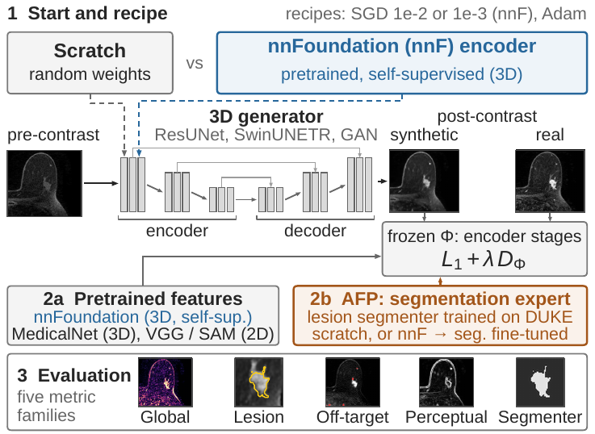

# Lesion-Centred Evaluation of Pretraining and Feature Losses for 3D Breast MRI Contrast Synthesis

Arthur Longuefosse, Cecilia Diana-Albelda, Jun Seita — submitted to ISBI 2027.

Virtual contrast enhancement predicts the post-contrast breast MRI from the pre-contrast scan. On the MAMA-MIA DUKE
cohort (91 test patients), we compare two uses of the 3D foundation model nnFoundation, as generator pretraining or
as a frozen feature loss, with an anatomical feature-prioritized (AFP) loss computed on a tumour-segmentation expert
and with generic perceptual losses, on three generators and three training recipes. Every model is evaluated in five
metric families: global, lesion, off-target, perceptual and downstream segmentation.

<p align="center"></p>

## Highlights

- **Pretraining beats feature loss.** nnFoundation helps most as generator pretraining combined with AFP_seg, which
  ranks first and has the lowest lesion error; used as a frozen feature loss, it ranks fifth.
- **Global similarity hides lesion errors.** Plain L1 has the best PSNR and MAE but recovers only about half of the
  tumour enhancement; AFP_seg recovers more of it and gives the best downstream segmentation.
- **Generic perceptual losses lose the lesion.** VGG16 and SAM 2.1 produce the least false enhancement, but the three
  perceptual losses (with MedicalNet) recover only 17–34 % of the tumour enhancement.

## Results

Test set, 91 patients, means. One metric per family (two for the lesion); all 14 metrics are in the table below it.
Best in **bold**, second <u>underlined</u>. Model names link to their configuration.

| Model | Pretrained | Rank ↓ | PSNR ↑ | Lesion MAE ↓ | r ↑ | FE ↓ | DINO ↑ | Dice ↑ |
|---|:---:|:---:|---:|---:|---:|---:|---:|---:|
| Pre-contrast copy | | – | 26.05 | 4.81 | 0% | – | 0.824 | 0.266 |
| Real post-contrast | | – | – | – | 100% | 0 | – | 0.586 |
| ***ResUNet · nnF recipe*** | | | | | | | | |
| [L1](configs/arms/l1_off.yaml) | – | 3 | **30.04** | 3.06 | 54% | 13.2 | 0.742 | 0.318 |
| [L1](configs/arms/l1_nnfoff.yaml) | ✓ | 4 | <u>29.99</u> | 3.12 | 53% | 10.8† | 0.729 | 0.324 |
| [L1 + AFP_seg](configs/arms/mam_scratch300_off.yaml) | – | <u>2</u> | 29.87 | 3.04 | <u>57%</u> | 23.5 | 0.823† | 0.351† |
| [L1 + AFP_seg](configs/arms/mam_scratch300_nnfoff.yaml) | ✓ | **1** | 29.61 | **2.93**† | **59%**† | 15.1 | 0.818† | **0.386**† |
| [L1 + feat. nnF](configs/arms/ssl_off.yaml) | – | 5 | 29.93 | 3.06 | 56% | 18.3 | 0.750† | 0.313 |
| ***ResUNet · common recipe*** | | | | | | | | |
| [L1 + AFP_seg-ft-nnF](configs/arms/mam300.yaml) | – | 7 | 29.37 | 3.03 | 52% | 16.7 | 0.772† | 0.343 |
| [L1 + perc. SAM 2.1](configs/arms/sam.yaml) | – | 9 | 29.33 | 3.47 | 34% | <u>10.5</u>† | **0.842**† | 0.309 |
| [L1 + perc. VGG16](configs/arms/vgg.yaml) | – | 12 | 28.87 | 4.09 | 17% | **6.5**† | 0.708 | 0.257 |
| [L1 + perc. MedicalNet](configs/arms/mednet.yaml) | – | 13 | 27.33 | 3.62 | 32% | 18.2 | 0.803† | 0.246 |
| ***SwinUNETR and GAN · Adam*** | | | | | | | | |
| [SwinUNETR: L1](configs/arms/swin_l1.yaml) | – | 11 | 29.75 | 3.31 | 44% | 10.9 | 0.751 | 0.294 |
| [SwinUNETR: L1 + AFP_seg](configs/arms/swin_mam_scratch300.yaml) | – | 10 | 29.16 | 3.15† | 46% | 17.5 | <u>0.824</u>† | 0.340† |
| [GAN: L1](configs/arms/gan_nnf.yaml) | ✓ | 6 | 29.65 | <u>3.02</u> | 49% | 22.9 | 0.757 | 0.350 |
| [GAN: L1 + AFP_seg](configs/arms/gan_nnf_mam_scratch300.yaml) | ✓ | 8 | 29.28 | **2.93** | 55%† | 30.1 | 0.811† | <u>0.364</u> |

† Significantly better than the first L1 row of the same architecture (paired patient bootstrap, 95% CI, uncorrected,
one training seed).

<details>
<summary><b>All 14 metrics</b></summary>

<br>

| Model | Pretr. | Rank ↓ | PSNR ↑ | MAE ↓ | SSIM ↑ | Lesion MAE ↓ | r ↑ | FE ↓ | DINO ↑ | LPIPS_L ↓ | \|∇\| ↑ | Dice ↑ | FP mL ↓ |
|---|:---:|:---:|---:|---:|---:|---:|---:|---:|---:|---:|---:|---:|---:|
| Pre-contrast copy | | – | 26.05 | 0.681 | 0.541 | 4.81 | 0% | – | 0.824 | 0.467 | 0.45 | 0.266 | 14.20 |
| Real post-contrast | | – | – | – | – | – | 100% | 0 | – | – | 1.00 | 0.586 | 8.85 |
| ***ResUNet · nnF recipe*** | | | | | | | | | | | | | |
| L1 | – | 3 | **30.04** | **0.461** | <u>0.670</u> | 3.06 | 54% | 13.2 | 0.742 | 0.399 | 0.53 | 0.318 | 13.92 |
| L1 | ✓ | 4 | <u>29.99</u> | <u>0.463</u> | **0.671** | 3.12 | 53% | 10.8† | 0.729 | 0.402 | 0.53 | 0.324 | 14.22 |
| L1 + AFP_seg | – | <u>2</u> | 29.87 | 0.473 | 0.661 | 3.04 | <u>57%</u> | 23.5 | 0.823† | 0.386† | <u>0.64</u>† | 0.351† | 12.72 |
| L1 + AFP_seg | ✓ | **1** | 29.61 | 0.486 | 0.643 | **2.93**† | **59%**† | 15.1 | 0.818† | **0.378**† | **0.65**† | **0.386**† | **11.43**† |
| L1 + feat. nnF | – | 5 | 29.93 | 0.464 | 0.665 | 3.06 | 56% | 18.3 | 0.750† | 0.388† | 0.57† | 0.313 | 14.12 |
| ***ResUNet · common recipe*** | | | | | | | | | | | | | |
| L1 + AFP_seg-ft-nnF | – | 7 | 29.37 | 0.493 | 0.651 | 3.03 | 52% | 16.7 | 0.772† | 0.387† | 0.59† | 0.343 | 18.38 |
| L1 + perc. SAM 2.1 | – | 9 | 29.33 | 0.504 | 0.637 | 3.47 | 34% | <u>10.5</u>† | **0.842**† | 0.415 | 0.48 | 0.309 | 14.65 |
| L1 + perc. VGG16 | – | 12 | 28.87 | 0.517 | 0.630 | 4.09 | 17% | **6.5**† | 0.708 | 0.471 | 0.37 | 0.257 | 18.35 |
| L1 + perc. MedicalNet | – | 13 | 27.33 | 0.614 | 0.586 | 3.62 | 32% | 18.2 | 0.803† | 0.440 | 0.43 | 0.246 | 15.50 |
| ***SwinUNETR and GAN · Adam*** | | | | | | | | | | | | | |
| SwinUNETR: L1 | – | 11 | 29.75 | 0.474 | 0.658 | 3.31 | 44% | 10.9 | 0.751 | 0.416 | 0.48 | 0.294 | 15.43 |
| SwinUNETR: L1 + AFP_seg | – | 10 | 29.16 | 0.507 | 0.635 | 3.15† | 46% | 17.5 | <u>0.824</u>† | 0.405† | 0.58† | 0.340† | 14.00 |
| GAN: L1 | ✓ | 6 | 29.65 | 0.480 | 0.655 | <u>3.02</u> | 49% | 22.9 | 0.757 | 0.393 | 0.53 | 0.350 | <u>12.29</u> |
| GAN: L1 + AFP_seg | ✓ | 8 | 29.28 | 0.502 | 0.638 | **2.93** | 55%† | 30.1 | 0.811† | <u>0.379</u>† | <u>0.64</u>† | <u>0.364</u> | 17.03 |

</details>

**Reading the table**

- **Metrics** ([docs/metrics.md](docs/metrics.md)): global = PSNR, MAE, SSIM in the body; lesion = MAE in the tumour
  and enhancement recovery r; off-target = false-enhancement regions (FE); perceptual = MedDINOv3 on the whole image,
  LPIPS in the tumour (LPIPS_L) and the gradient-norm ratio \|∇\| around the tumour; segmentation = Dice and
  false-positive volume of the MAMA-MIA nnU-Net. MAE is in z, i.e. pre-contrast standard deviations.
- **Rank**: averaged per family, then over the five families (exploratory). SAM 2.1 and SwinUNETR + AFP_seg tie
  (0.564) and are ordered as listed.
- **Pretrained**: generator encoder initialised from nnFoundation (✓) or from scratch (–).
- **Losses**: AFP_seg = encoder features of a lesion segmenter trained from scratch on DUKE; AFP_seg-ft-nnF = the same
  with a segmenter fine-tuned from nnFoundation; feat. nnF = frozen nnFoundation encoder features.
- **Recipes** ([docs/recipes.md](docs/recipes.md), with every other trained model): nnF = SGD lr 1e-3 with a 15-epoch
  warm-up (official nnFoundation fine-tuning); common = SGD lr 1e-2; Adam = the SwinUNETR and GAN recipes.

## Repository

```
configs/      one YAML per model (arms/), segmentation experts, loss weights (doses/), evaluation settings (eval/)
synthesis/    training: data, generators (ResUNet, SwinUNETR, PatchGAN), losses and AFP teachers, trainers, inference
evaluation/   metrics of the five families, per-model aggregation, family rank, paired bootstrap
scripts/      entry points: train_arm.sh, train_expert.sh, calibrate.sh, eval_test91.sh
tests/        CPU equivalence checks against the original experiment code (docs/testing.md)
docs/         recipes.md, metrics.md, testing.md
```

## Setup

Python 3.10, two environments, because the training and the evaluation use different nnU-Net packages:

| Environment | Requirements | Used for |
|---|---|---|
| training | `requirements/train.txt` | nnUNet_translation and dynamic-network-architectures forks (tag `isbi2027-results`); training, calibration, inference |
| evaluation | `requirements/eval.txt` | stock nnunetv2 2.6.2 (MAMA-MIA segmenter), LPIPS, MedDINOv3 |

```bash
# training environment: install the pinned packages first, then the two tagged forks without dependencies
python -m pip install -r <(sed '/@ git+/d' requirements/train.txt)
python -m pip install --no-deps -r <(sed -n '/@ git+/p' requirements/train.txt)
```

Data and weights are not redistributed: download MAMA-MIA, nnFoundationCNN, MedicalNet, SAM 2.1 and VGG16 under their
own licences, copy `scripts/env.example.sh` to `scripts/env.sh`, set the paths, and `source scripts/env.sh`.

## Usage

```bash
# 1. data: DUKE split and preprocessing
python -m synthesis.data.split --mama-root /path/to/MAMA-MIA --out split_manifest.json --check configs/split_duke.json
python -m synthesis.data.preprocess --manifest split_manifest.json --splits train dev --out $ISBI_DATA
python -m synthesis.data.preprocess --manifest split_manifest.json --splits test --out $ISBI_TEST_DATA

# 2. segmentation experts (AFP teachers), then any model of configs/arms/
bash scripts/train_expert.sh scratch
bash scripts/train_arm.sh mam_scratch300_nnfoff      # second argument: device, default cuda:0

# 3. test-set evaluation (evaluation environment; stages: gen read cpu lpips percep table)
bash scripts/eval_test91.sh gen read cpu lpips percep table
```

The variables each evaluation stage needs are listed at the top of `scripts/eval_test91.sh`.

## Citation

```bibtex
@inproceedings{longuefosse2027lesion,
  title     = {Lesion-Centred Evaluation of Pretraining and Feature Losses for 3D Breast MRI Contrast Synthesis},
  author    = {Longuefosse, Arthur and Diana-Albelda, Cecilia and Seita, Jun},
  booktitle = {IEEE International Symposium on Biomedical Imaging (ISBI)},
  year      = {2027},
  note      = {submitted}
}
```

## License

Code under the [MIT License](LICENSE). MAMA-MIA data and the pretrained weights keep their own licences.
